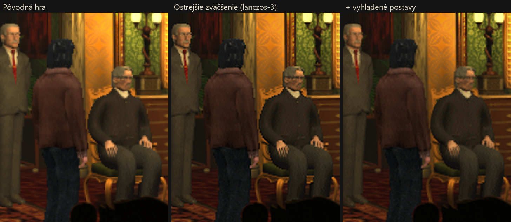
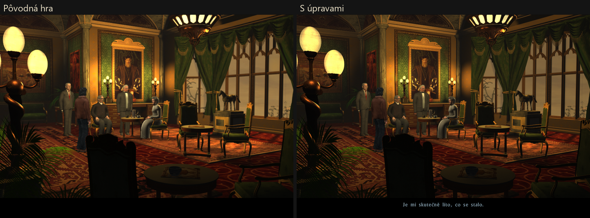
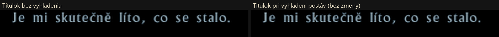
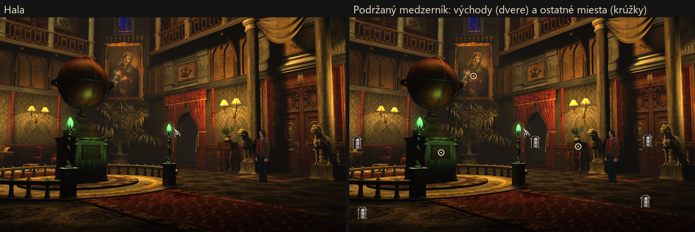

# Black Mirror (Posel smrti) – vylepšenia hrania

Úpravy pre pôvodnú hru Black Mirror z roku 2003 (verzia zo Steamu, engine AGDS). Pôvodné súbory hry sa nemenia: všetko robia doplnkové knižnice v priečinku hry. Každú úpravu (okrem zobrazenia) môžeš v `config.ini` zapnúť alebo vypnúť.

## Zoznam vylepšení

### Obraz
- **Celá obrazovka bez okraja a v pomere 4:3** – hra beží v okne bez rámu cez celú obrazovku (Alt+Tab bez prepínania režimu) a obraz má správny pomer strán s čiernymi pásmi po bokoch. Funguje aj pri zväčšení písma vo Windows nad 100 %.
- **Filmy na celú šírku** – širokouhlé filmové scény sa roztiahnu na celú šírku obrazovky, bez pomeru 4:3 s čiernymi pásmi okolo.
- **Ostrejší obraz** – zväčšenie obrazu 800×600 na tvoje rozlíšenie robí ostrejší filter (lanczos-3).
- **Vyhladenie postáv** – zubaté hrany postáv sa vyhladia ešte pred zväčšením obrazu. Ponuky, titulky a texty sa nevyhladzujú, takže písmo ostáva čisté.
- **Bez zvyškov na obrazovke** – po rýchlom pohybe myši už nezostávajú na obraze zvyšky nápisov a kurzora.

### Myš
- **Plynulý kurzor** – kurzor sa prekresľuje 60-krát za sekundu namiesto 25. Hra pritom ide rovnakou rýchlosťou ako pôvodne.
- **Citlivosť myši** – kurzor je predvolene pomalší (0.7 z pôvodnej rýchlosti), dá sa nastaviť.
- **Koliesko myši listuje inventárom** – točením kolieska vyberáš predmety z inventára priamo na kurzor (dole = ďalší, hore = predchádzajúci), bez otvárania lišty dole.

### Klávesy
| Kláves | Čo robí |
|---|---|
| **ESC** v hre | otvorí ponuku (ako klik na ozubené kolieska vpravo hore) |
| **ESC** v ponuke | návrat do hry (zo Nastavení, Uložit/Nahrát hru a Tvůrci späť do hlavnej ponuky) |
| **F5** | obrazovka Uložit hru (ESC vráti rovno do hry) |
| **F8** | obrazovka Nahrát hru (ESC vráti rovno do hry) |
| **medzerník** (podržaný) v hre | ukáže všetky aktívne miesta v scéne: východy ikonou dverí, ostatné miesta krúžkom |
| **medzerník** počas rozhovoru | preskočí jednu repliku (aj vetu rozprávača) |
| **ESC** počas rozhovoru | preskočí repliku aj všetky animácie a hudbu po nej až po ďalšiu repliku |
| **ESC** podržaný počas rozhovoru | preskočí celý rozhovor až po chvíľu, keď znova ovládaš hru |
| **Tab** | ukáže východy (pôvodná funkcia hry) |

Počas rozhovorov už ostatné klávesy (napríklad písmená) repliky nepreskakujú – v pôvodnej hre to robil ktorýkoľvek kláves.

### Nastavenia
- **Nastavenia sa pamätajú** – titulky, hlasitosť reči, zvuku a hudby a gama korekcia platia stále, bez ohľadu na to, ktorú uloženú hru načítaš. Pôvodná hra ich pri každom spustení a načítaní pozície prepísala (napríklad titulky sa vždy vypli).

## Ukážky pred a po

### Vyhladenie postáv
Výrez zväčšený 2×: pôvodná hra (rozmazané zväčšenie so zubatými hranami), ostrejšie zväčšenie a k nemu vyhladené hrany postáv.

Celá scéna – pôvodná hra a hra s úpravami (s úpravami sú aj titulky zapnuté natrvalo):

Vyhladzujú sa len postavy v scéne. Titulky, názvy predmetov a ponuky ostávajú presne také ako bez vyhladenia (overené pixel po pixeli, hlavná ponuka je s vyhladením aj bez neho úplne rovnaká):

### Aktívne miesta (podržaný medzerník)

### Filmy na celú šírku

## Inštalácia
1. Spusti `install.bat`. Hru hľadá v `D:\Hry\Steam\steamapps\common\Black Mirror`. Ak ju máš inde, zadaj cestu ako parameter, napríklad `install.bat "C:\Hry\Black Mirror"`.
2. Spusti hru ako zvyčajne.

Inštalácia skopíruje do priečinka hry knižnice `DDraw.dll`, `bm_core.dll`, `dgddraw.dll` a `D3DImm.dll` (dgVoodoo2 2.87.6), nastavenia `dgVoodoo.conf` a `config.ini` a doplní dve voľby do `agds.cfg`. Existujúci `config.ini` neprepíše, takže tvoje nastavenia ostanú.

**Odinštalovanie:** `uninstall.bat` súbory zmaže a vráti hru do pôvodného stavu.

## Nastavenia (`config.ini` v priečinku hry)
| Sekcia, kľúč | Predvolené | Význam |
|---|---|---|
| `[Movies] FullWidth` | 1 | filmy na celú šírku (0 = v obraze 4:3) |
| `[Cursor] Fps` | 60 | prekresľovanie kurzora za sekundu (0 = ako pôvodná hra) |
| `[Cursor] Sensitivity` | 0.7 | citlivosť myši 0.1 – 1.0 (1.0 = pôvodná rýchlosť) |
| `[Controls] EscapeMenu` | 1 | ESC otvorí ponuku |
| `[Controls] SpaceHotspots` | 1 | medzerník ukáže aktívne miesta |
| `[Controls] HoldToSkip` | 1 | preskakovanie rozhovorov cez ESC a medzerník |
| `[Controls] SaveLoadKeys` | 1 | F5 = uložiť, F8 = nahrať |
| `[Controls] WheelInventory` | 1 | koliesko myši listuje inventárom |
| `[Video] Smoothing` | 1 | vyhladenie: 1 = postavy, 2 = celá scéna, 0 = vypnuté |
| `[Video] SmoothingThreshold` | 25 | citlivosť vyhladenia (vyššie číslo = menej vyhladených hrán) |
| `[Settings] Remember` | 1 | pamätať nastavenia bez ohľadu na uloženú hru |

Hodnoty zmenené v nastaveniach hry si doplnok zapisuje do sekcie `[Remembered]`. Zmeny v `config.ini` platia po reštarte hry. Ostrosť zväčšenia sa mení v `dgVoodoo.conf` (`Resampling = lanczos-3`, mäkšie `bicubic` alebo pôvodné `bilinear`).

## Pre vývojárov
Technický popis, adresy v hre, merania a postupy testov sú v [DOKUMENTACIA.md](DOKUMENTACIA.md). Doplnky sa zostavujú cez `build_plugin.bat`; zdroj nového doplnku je `doplnok/bm_qol.c` a pôvodný sa skladá cez `nastroje/zostav_dll.py`.
