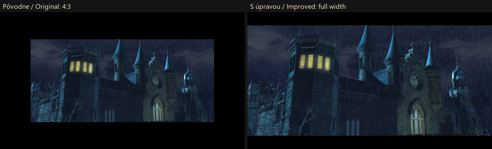

# Black Mirror (Posel smrti) – vylepšenia hrania / Quality of life fixes

> **Verzia hry / Game version:** Black Mirror I zo Steamu (App ID 292930, build 503461), česká verzia „Posel smrti“ 1.1, `agds.exe` z 8. 9. 2005 (671 744 B). Iné verzie neboli skúšané – doplnky si pri spustení overia súbor hry a v inej verzii svoje úpravy vypnú (celá obrazovka a pomer 4:3 cez dgVoodoo fungujú ďalej).
>
> *Black Mirror I from Steam (App ID 292930, build 503461), Czech version “Posel smrti” 1.1, `agds.exe` dated 8 Sep 2005 (671,744 bytes). Other versions were not tested – the plugins check the game file on startup and switch their changes off in a different version (full screen and 4:3 via dgVoodoo keep working).*

Úpravy pre pôvodnú hru Black Mirror z roku 2003 (engine AGDS). Pôvodné súbory hry sa nemenia: všetko robia doplnkové knižnice v priečinku hry. Každú úpravu (okrem zobrazenia) môžeš v `config.ini` zapnúť alebo vypnúť.

*Improvements for the original 2003 game Black Mirror (AGDS engine). The original game files are not modified: everything is done by add-on libraries in the game folder. Every improvement (except the display) can be switched on or off in `config.ini`.*

## Zoznam vylepšení / List of improvements

### Obraz / Display
- **Celá obrazovka bez okraja a v pomere 4:3** – hra beží v okne bez rámu cez celú obrazovku (Alt+Tab bez prepínania režimu) a obraz má správny pomer strán s čiernymi pásmi po bokoch. Funguje aj pri zväčšení písma vo Windows nad 100 %. 
  *Borderless full screen in 4:3* – the game runs in a borderless window covering the whole screen (Alt+Tab without mode switching) with the correct aspect ratio and black bars on the sides. Works with Windows display scaling above 100 % too.
- **Filmy na celú šírku** – širokouhlé filmové scény sa roztiahnu na celú šírku obrazovky, bez pomeru 4:3 s čiernymi pásmi okolo. 
  *Full-width movies* – widescreen cutscene movies fill the whole screen width instead of sitting inside the 4:3 picture with black bars around them.
- **Ostrejší obraz** – zväčšenie obrazu 800×600 na tvoje rozlíšenie robí ostrejší filter (lanczos-3). 
  *Sharper picture* – the 800×600 picture is upscaled to your resolution with a sharper filter (lanczos-3).
- **Vyhladenie postáv** – zubaté hrany postáv sa vyhladia ešte pred zväčšením obrazu. Ponuky, titulky a texty sa nevyhladzujú, takže písmo ostáva čisté. 
  *Character smoothing* – jagged edges of characters are smoothed before the picture is upscaled. Menus, subtitles and texts are not smoothed, so the font stays clean.
- **Bez zvyškov na obrazovke** – po rýchlom pohybe myši už nezostávajú na obraze zvyšky nápisov a kurzora. 
  *No leftovers on screen* – fast mouse movement no longer leaves traces of labels and the cursor.

### Myš / Mouse
- **Plynulý kurzor** – kurzor sa prekresľuje 60-krát za sekundu namiesto 25. Hra pritom ide rovnakou rýchlosťou ako pôvodne. 
  *Smooth cursor* – the cursor is redrawn 60 times per second instead of 25. The game itself runs at its original speed.
- **Citlivosť myši** – kurzor je predvolene pomalší (0.7 z pôvodnej rýchlosti), dá sa nastaviť. 
  *Mouse sensitivity* – the cursor is slower by default (0.7 of the original speed) and can be adjusted.
- **Koliesko myši listuje inventárom** – točením kolieska vyberáš predmety z inventára priamo na kurzor (dole = ďalší, hore = predchádzajúci), bez otvárania lišty dole. 
  *Mouse wheel cycles the inventory* – scrolling the wheel puts inventory items directly on the cursor (down = next, up = previous) without opening the bar at the bottom.

### Klávesy / Keys
| Kláves / Key | Čo robí | What it does |
|---|---|---|
| **ESC** v hre / in game | otvorí ponuku (ako klik na ozubené kolieska vpravo hore) | opens the menu (like clicking the cogwheels in the top right corner) |
| **ESC** v ponuke / in menu | návrat do hry (zo Nastavení, Uložit/Nahrát hru a Tvůrci späť do hlavnej ponuky) | back to the game (from Options, Save/Load and Credits back to the main menu) |
| **F5** | obrazovka Uložit hru (ESC vráti rovno do hry) | Save game screen (ESC returns straight to the game) |
| **F8** | obrazovka Nahrát hru (ESC vráti rovno do hry) | Load game screen (ESC returns straight to the game) |
| **medzerník / Space** v hre / in game | na 2 sekundy (ako Tab, pri držaní stále) ukáže všetky aktívne miesta v scéne: východy ikonou dverí, ostatné miesta krúžkom | shows all hotspots in the scene for 2 seconds (like Tab, permanently while held): exits with a door icon, everything else with a ring |
| **medzerník / Space** v rozhovore / in dialogue | preskočí jednu repliku (aj vetu rozprávača) | skips one line (also a narrator sentence) |
| **ESC** v rozhovore / in dialogue | preskočí repliku aj všetky animácie a hudbu po nej až po ďalšiu repliku | skips the line plus all animations and music after it, up to the next line |
| **ESC** podržaný / held, v rozhovore / in dialogue | preskočí celý rozhovor až po chvíľu, keď znova ovládaš hru | skips the whole conversation until you are in control again |
| **Tab** | na 2 sekundy ukáže východy (pôvodná funkcia hry) | shows the exits for 2 seconds (original game feature) |

Počas rozhovorov už ostatné klávesy (napríklad písmená) repliky nepreskakujú – v pôvodnej hre to robil ktorýkoľvek kláves.

*Other keys (letters, for example) no longer skip lines during dialogue – in the original game any key did.*

### Nastavenia / Settings
- **Nastavenia sa pamätajú** – titulky, hlasitosť reči, zvuku a hudby a gama korekcia platia stále, bez ohľadu na to, ktorú uloženú hru načítaš. Pôvodná hra ich pri každom spustení a načítaní pozície prepísala (napríklad titulky sa vždy vypli). 
  *Settings are remembered* – subtitles, speech, sound and music volume and gamma stay as you set them regardless of the saved game you load. The original game overwrote them on every start and load (subtitles were always switched off, for example).

## Ukážky pred a po / Before and after

### Vyhladenie postáv / Character smoothing
Výrez zväčšený 2×: pôvodná hra (rozmazané zväčšenie so zubatými hranami), ostrejšie zväčšenie a k nemu vyhladené hrany postáv.

*Detail enlarged 2×: the original game (blurry upscaling with jagged edges), sharper upscaling, and sharper upscaling with smoothed character edges.*

Celá scéna – pôvodná hra a hra s úpravami (s úpravami sú aj titulky zapnuté natrvalo):

*The whole scene – original game and the game with improvements (with improvements the subtitles also stay switched on):*

Vyhladzujú sa len postavy v scéne. Titulky, názvy predmetov a ponuky ostávajú presne také ako bez vyhladenia (overené pixel po pixeli, hlavná ponuka je s vyhladením aj bez neho úplne rovnaká):

*Only the characters in the scene are smoothed. Subtitles, object names and menus stay exactly as they are without smoothing (checked pixel by pixel; the main menu is identical with and without smoothing):*

### Aktívne miesta (medzerník) / Hotspots (Space)

### Filmy na celú šírku / Full-width movies

## Inštalácia / Installation
1. Rozbaľ archív kamkoľvek a spusti `install.bat`. Hru nájde sám v Steame (aj v ďalších knižniciach Steamu na iných diskoch), prípadne v priečinku nad sebou, ak archív rozbalíš priamo do priečinka hry. Ak hru nenájde (napríklad verzia mimo Steamu), pretiahni priečinok hry myšou na `install.bat` alebo zadaj cestu: `install.bat "C:\Hry\Black Mirror"`. 
   *Extract the archive anywhere and run `install.bat`. It finds the game in Steam by itself (including other Steam libraries on other drives), or in the folder above it if you extract the archive directly into the game folder. If it cannot find the game (a non-Steam version, for example), drag the game folder onto `install.bat` or pass the path: `install.bat "C:\Games\Black Mirror"`.*
2. Spusti hru ako zvyčajne. 
   *Start the game as usual.*

Inštalácia skopíruje do priečinka hry knižnice `DDraw.dll`, `bm_core.dll`, `dgddraw.dll` a `D3DImm.dll` (dgVoodoo2 2.87.6), nastavenia `dgVoodoo.conf` a `config.ini` a doplní dve voľby do `agds.cfg`. Existujúci `config.ini` neprepíše, takže tvoje nastavenia ostanú. Poznámky v `config.ini` sú po slovensky na slovenskom alebo českom Windows, inak po anglicky.

*The installer copies the libraries `DDraw.dll`, `bm_core.dll`, `dgddraw.dll` and `D3DImm.dll` (dgVoodoo2 2.87.6) and the settings files `dgVoodoo.conf` and `config.ini` into the game folder and adds two options to `agds.cfg`. An existing `config.ini` is not overwritten, so your settings are kept. The comments in `config.ini` are in Slovak on Slovak or Czech Windows, otherwise in English.*

**Odinštalovanie:** `uninstall.bat` súbory zmaže a vráti hru do pôvodného stavu.

***Uninstall:** `uninstall.bat` removes the files and restores the game to its original state.*

## Nastavenia / Settings (`config.ini` v priečinku hry / in the game folder)
| Sekcia, kľúč / Section, key | Predvolené / Default | Význam | Meaning |
|---|---|---|---|
| `[Movies] FullWidth` | 1 | filmy na celú šírku (0 = v obraze 4:3) | full-width movies (0 = inside the 4:3 picture) |
| `[Cursor] Fps` | 60 | prekresľovanie kurzora za sekundu (0 = ako pôvodná hra) | cursor redraws per second (0 = like the original game) |
| `[Cursor] Sensitivity` | 0.7 | citlivosť myši 0.1 – 1.0 (1.0 = pôvodná rýchlosť) | mouse sensitivity 0.1 – 1.0 (1.0 = original speed) |
| `[Controls] EscapeMenu` | 1 | ESC otvorí ponuku | ESC opens the menu |
| `[Controls] SpaceHotspots` | 1 | medzerník ukáže aktívne miesta | Space shows hotspots |
| `[Controls] HoldToSkip` | 1 | preskakovanie rozhovorov cez ESC a medzerník | skipping dialogue with ESC and Space |
| `[Controls] SaveLoadKeys` | 1 | F5 = uložiť, F8 = nahrať | F5 = save, F8 = load |
| `[Controls] WheelInventory` | 1 | koliesko myši listuje inventárom | mouse wheel cycles the inventory |
| `[Video] Smoothing` | 1 | vyhladenie: 1 = postavy, 2 = celá scéna, 0 = vypnuté | smoothing: 1 = characters, 2 = whole scene, 0 = off |
| `[Video] SmoothingThreshold` | 25 | citlivosť vyhladenia (vyššie číslo = menej vyhladených hrán) | smoothing sensitivity (higher = fewer edges smoothed) |
| `[Settings] Remember` | 1 | pamätať nastavenia bez ohľadu na uloženú hru | remember settings regardless of the saved game |

Hodnoty zmenené v nastaveniach hry si doplnok zapisuje do sekcie `[Remembered]`. Zmeny v `config.ini` platia po reštarte hry. Ostrosť zväčšenia sa mení v `dgVoodoo.conf` (`Resampling = lanczos-3`, mäkšie `bicubic` alebo pôvodné `bilinear`).

*Values changed in the game's options are stored by the plugin in the `[Remembered]` section. Changes in `config.ini` take effect after restarting the game. Upscaling sharpness is set in `dgVoodoo.conf` (`Resampling = lanczos-3`, softer `bicubic` or the original `bilinear`).*

## Použité nástroje / Credits
Preklad DirectDraw na Direct3D 11 robí [dgVoodoo2](https://github.com/dege-diosg/dgVoodoo2) 2.87.6 od Dégé (freeware), ktorý je súčasťou balíka.

*DirectDraw is translated to Direct3D 11 by [dgVoodoo2](https://github.com/dege-diosg/dgVoodoo2) 2.87.6 by Dégé (freeware), included in the package.*

## Pre vývojárov / For developers
Technický popis, adresy v hre, merania a postupy testov sú v [DOKUMENTACIA.md](DOKUMENTACIA.md) (po slovensky). Doplnky sa zostavujú cez `build_plugin.bat`; zdroj nového doplnku je `doplnok/bm_qol.c` a pôvodný sa skladá cez `nastroje/zostav_dll.py`.

*The technical description, game addresses, measurements and test procedures are in [DOKUMENTACIA.md](DOKUMENTACIA.md) (in Slovak). The plugins are built with `build_plugin.bat`; the source of the new plugin is `doplnok/bm_qol.c` and the original one is assembled by `nastroje/zostav_dll.py`.*
